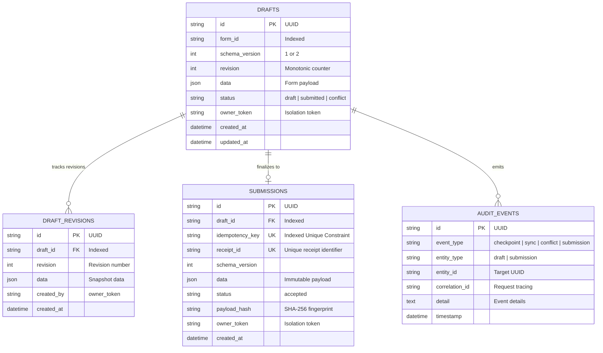

# FormRelay — Offline-First Form Recovery Infrastructure

[](https://github.com/formrelay/formrelay/actions/workflows/ci.yml)
[](https://fastapi.tiangolo.com)
[](https://react.dev)
[](https://www.typescriptlang.org)
[](https://dexie.org)

**FormRelay** is an industrial-strength, offline-first form recovery system designed to eliminate form progress loss caused by browser crashes, accidental reloads, network drops, server restarts, and expired sessions.

FormRelay demonstrates these capabilities through a realistic **Excellence in Engineering Scholarship Application**, backed by an automated 3-way merge conflict resolver, forward schema evolution engine (v1 → v2), and effectively-once idempotent submission pipeline.

---

## Architecture Overview

```mermaid
graph TD
    subgraph Browser ["Client (Browser Profile)"]
        UI["Scholarship Form Wizard (React 19)"]
        Engine["FormRelay Recovery Engine"]
        IDB[("Dexie IndexedDB\n• Drafts\n• Sync Queue\n• Audit Events")]
        NetProbe["Network & Health Probe"]
        
        UI <-->|Debounced Keystroke Save| Engine
        Engine <-->|Local Checkpointing| IDB
        Engine <-->|Heartbeat Ping| NetProbe
    end

    subgraph Server ["Backend (FastAPI & SQLAlchemy 2)"]
        API["FastAPI REST Endpoints\n(Correlation IDs & Owner Token Guard)"]
        SyncService["Sync & 3-Way Merge Service"]
        MigrationService["Schema Evolution Engine (v1 ↔ v2)"]
        SubmitService["Idempotent Submission Engine"]
    end

    subgraph Storage ["Database Persistence"]
        DB[("PostgreSQL 16 / SQLite\n• drafts\n• draft_revisions\n• submissions\n• audit_events")]
    end

    NetProbe -->|Periodic Heartbeat| API
    Engine -->|POST /api/drafts/{id}/sync| SyncService
    Engine -->|POST /api/schema/migrate| MigrationService
    Engine -->|POST /api/submissions| SubmitService
    
    SyncService --> DB
    MigrationService --> DB
    SubmitService --> DB
```

---

## Data Model Diagram



---

## Core Features & Engineering Guarantees

1. **Debounced Local Checkpointing**:
   - Keystrokes are buffered locally in Dexie IndexedDB with a 400ms debounce.
   - Survives browser refreshes, tab closures, and process kills without requiring a network connection.
2. **Deterministic 3-Way Merge & Conflict Resolution**:
   - Revisions track `baseRevision`, `localRevision`, and `serverRevision`.
   - Rejects naive Last-Write-Wins (LWW). When two clients edit different fields, FormRelay automatically fast-forwards and merges them. When identical fields diverge, it triggers an interactive side-by-side diff chooser.
3. **Effectively-Once Idempotent Submissions**:
   - Every submission generates a cryptographic UUID idempotency key attached to the client draft.
   - Retrying a submission with identical key and payload safely returns the existing submission record and receipt ID with HTTP 200 (not 201), backed by an atomic database constraint.
   - Concurrent duplicate submissions are serialized atomically using transaction rollback and lookup recovery.
4. **Forward Schema Evolution (v1 → v2)**:
   - Field-level mapping mechanism automatically transforms legacy v1 records into v2 specifications.
   - Computes defaults for new fields (`gpa_scale`, `major`, `minor`, `portfolio_url`, `resume_available`), preserves compatible fields, and provides an audited migration report.
5. **Interactive Failure-Injection Laboratory**:
   - 10 developer-executable real-world scenarios:
     1. Page Reload Recovery
     2. Offline Editing Simulation
     3. Network Reconnect & Auto-sync
     4. Simulated Network Timeout
     5. Idempotent Submission Retry
     6. Server Validation Error (HTTP 422)
     7. Create Revision Conflict (HTTP 409)
     8. Schema v1 → v2 Migration
     9. Server Restart / 503 Transient Simulation
     10. Concurrent Duplicate Submissions (Race condition test)
6. **Observability & Reliability Metrics**:
   - Structured backend logging with correlation IDs.
   - Live probes at `/health` and `/ready`.
   - Browser client recovery audit log (sensitive user data and passwords are never logged).
   - Measured reliability benchmark table.

---

## Repository Structure

```
Form Relay/
├── .github/
│   └── workflows/
│       └── ci.yml               # GitHub Actions workflow for backend & frontend
├── backend/
│   ├── alembic/                 # Alembic database migrations
│   │   ├── versions/            # Migration scripts (initial_schema)
│   │   └── env.py               # Async Alembic runner
│   ├── app/
│   │   ├── config.py            # Pydantic Settings configuration
│   │   ├── database.py          # SQLAlchemy 2 async engine & sessionmaker
│   │   ├── logging_config.py    # Structured JSON / console logger
│   │   ├── main.py              # FastAPI application & middleware
│   │   ├── migration.py         # Schema v1 <-> v2 evolution engine
│   │   ├── models.py            # SQLAlchemy Declarative models
│   │   ├── routes.py            # REST API endpoints
│   │   ├── schemas.py           # Pydantic validation schemas
│   │   └── services.py          # Core business logic & transaction boundaries
│   ├── tests/
│   │   └── test_api.py          # 23 automated backend pytest test cases
│   ├── alembic.ini              # Alembic config
│   ├── Dockerfile               # Production Python 3.12 container
│   └── pyproject.toml           # Backend packaging & dependencies
├── frontend/
│   ├── src/
│   │   ├── api/
│   │   │   └── client.ts        # Typed API client with simulation flags & retry
│   │   ├── components/
│   │   │   ├── common/
│   │   │   │   └── StatusBanner.tsx    # Live checkpoint chip & storage notice
│   │   │   ├── conflict/
│   │   │   │   └── ConflictResolver.tsx# Side-by-side 3-way merge resolver
│   │   │   ├── diagnostics/
│   │   │   │   └── ObservabilityView.tsx # Metrics & client audit trail
│   │   │   ├── laboratory/
│   │   │   │   └── FailureLab.tsx      # 10 failure injection scenarios
│   │   │   ├── layout/
│   │   │   │   └── Navbar.tsx          # Navigation & owner token pill
│   │   │   ├── migration/
│   │   │   │   └── SchemaMigrator.tsx  # Schema v1 -> v2 review engine
│   │   │   ├── receipt/
│   │   │   │   └── SubmissionReceipt.tsx# Confetti receipt with idempotency test
│   │   │   └── scholarship/
│   │   │       └── ScholarshipWizard.tsx# Multi-step scholarship wizard
│   │   ├── recovery/
│   │   │   ├── db.ts            # Dexie IndexedDB database configuration
│   │   │   ├── defaults.ts      # V1 & V2 initial fixtures
│   │   │   ├── diff.ts          # Object flattening, equality & 3-way merge
│   │   │   ├── engine.ts        # FormRelay recovery engine singleton
│   │   │   └── types.ts         # TypeScript recovery types
│   │   ├── test/
│   │   │   ├── setup.ts         # Vitest + fake-indexeddb setup
│   │   │   ├── components.test.tsx # UI component tests
│   │   │   └── recovery.test.ts # Engine & diff unit tests
│   │   ├── App.tsx              # Router definition
│   │   ├── index.css            # Modern CSS design system
│   │   └── main.tsx             # React entry point
│   ├── Dockerfile               # Multi-stage production Nginx container
│   ├── nginx.conf               # SPA routing & API reverse proxy
│   ├── package.json             # Frontend dependencies & vitest scripts
│   └── vite.config.ts           # Vite + Vitest configuration
├── .env.example                 # Environment variable templates
├── .gitignore                   # Secrets and build ignore rules
├── docker-compose.yml           # PostgreSQL, Backend & Frontend orchestration
├── Makefile                     # Developer command runner
└── README.md                    # Project documentation
```

---

## Quick Start & Running Locally

### Prerequisites
- Node.js 20+ and npm
- Python 3.12+ (or 3.10+)
- (Optional) Docker and Docker Compose

### 1. Running with Docker Compose (Recommended)
```bash
# Clone the repository and spin up PostgreSQL, Backend, and Frontend
docker compose up --build
```
- Frontend: `http://localhost:5173`
- Backend API Docs: `http://localhost:8000/docs`
- Health check: `http://localhost:8000/health`

### 2. Running Locally Without Docker

#### Backend:
```bash
cd backend
python -m venv venv

# Windows:
.\venv\Scripts\activate
# Linux/macOS:
source venv/bin/activate

pip install -e .
alembic upgrade head
uvicorn app.main:app --reload --port 8000
```

#### Frontend:
```bash
cd frontend
npm install
npm run dev
```
Open `http://localhost:5173` in your browser.

---

## Environment Variables

Defined in `.env.example`:

| Variable | Description | Default |
| :--- | :--- | :--- |
| `DATABASE_URL` | SQLAlchemy async connection string | `sqlite+aiosqlite:///./formrelay.db` |
| `SECRET_KEY` | Cryptographic secret for signing | `change-me-to-a-random-secret-key` |
| `CORS_ORIGINS` | Permitted browser origins | `http://localhost:5173` |
| `API_PREFIX` | Prefix for REST routes | `/api` |
| `DEBUG` | Enable debug SQL logging | `false` |
| `VITE_API_URL` | Frontend API base URL | `http://localhost:8000` |

---

## Architecture & Concurrency Model

### Atomic Optimistic Concurrency Control (OCC)
FormRelay treats drafts as versioned entities with strictly monotonic revision counters (`revision: 1, 2, ... N`).
- **Atomic Conditional Updates**: All mutating operations (`update_draft`, `sync_draft`, `resolve_conflict`) execute as atomic SQL conditional updates:
  ```sql
  UPDATE drafts
  SET data = :data, revision = revision + 1, updated_at = :now
  WHERE id = :draft_id
    AND owner_token = :owner_token
    AND revision = :expected_revision
    AND status != 'submitted';
  ```
- **Silent Overwrite Prevention**: If two concurrent processes attempt to advance the same draft revision, the database serializes them. The transaction whose expected revision no longer matches receives `rowcount == 0`, immediately aborts the write, rolls back, and returns `HTTP 409 Conflict` with the latest server revision and server state.
- **Atomic Revision Snapshots & Auditing**: Every successful state transition commits the updated draft, an immutable `DraftRevision` snapshot (`draft_revisions`), and a structured `AuditEvent` within the **same atomic database transaction**. Any mid-transaction failure triggers a full rollback, leaving no partial state or orphan revision snapshots.

---

## Security Model & Limitations of `X-Owner-Token`

> [!WARNING]
> **Demo Authentication Notice**: `X-Owner-Token` is an ephemeral session-isolation token designed exclusively for demonstration purposes. **It is not production-grade authentication.**

### Known Authentication Limitations
1. **No Cryptographic Signatures**: `X-Owner-Token` is a client-generated UUID without cryptographic signing or tamper protection.
2. **No Expiration or Revocation**: Tokens do not support automated TTLs, sliding sessions, or revocation lists.
3. **No Centralized Identity Provider**: Tokens are not tied to a trusted Identity Provider (IdP) or directory service.
4. **Client-Side Storage**: In the demo, tokens are stored in browser `localStorage`. In untrusted environments, this is susceptible to XSS extraction.

### Production Deployment Guidance
When transitioning FormRelay to production:
1. **OAuth 2.0 / OpenID Connect (OIDC)**: Replace `X-Owner-Token` with JWT bearer tokens issued by an IdP (e.g., Keycloak, Auth0, Amazon Cognito).
2. **Token Validation**: Validate JWT digital signatures (`RS256`), issuer (`iss`), audience (`aud`), and expiration (`exp`) in FastAPI middleware on every request.
3. **Identity-Bound Ownership**: Extract the subject identifier (`sub`) from the validated JWT claims and bind resource ownership to `user_id`.
4. **Transport Security (TLS)**: Enforce TLS 1.3 with HTTP Strict Transport Security (`HSTS`) on all endpoints.
5. **Secure Cookie Delivery**: If using browser cookies for session tokens, specify `HttpOnly`, `Secure`, and `SameSite=Strict`.

---

## Database Migrations (Alembic)

FormRelay uses **Alembic** for explicit, version-controlled schema migrations. Reliance on `Base.metadata.create_all` has been removed from production startup to prevent DDL race conditions in multi-worker or containerized deployments.

### Running Migrations
```bash
# Apply all pending migrations to head
cd backend
alembic upgrade head

# Generate a new migration revision after model changes
alembic revision --autogenerate -m "describe_schema_change"

# Rollback the last migration
alembic downgrade -1
```

### Isolated Test Database Setup
Tests run against an isolated SQLite test database with `poolclass=NullPool`, ensuring each test executes in an isolated environment without connection or event-loop lock leaks across asynchronous test runs. Tables are created before each test and cleanly dropped afterward.

---

## Reproducible Test Commands

FormRelay features automated test coverage across both backend and frontend.

### 1. Backend Test Suite (Pytest)
```bash
cd backend
.\venv\Scripts\pytest tests/ -v
```
**Results: 32 passed in ~3.6s**
- Health & readiness probes (`/health`, `/ready`)
- Draft CRUD & strict owner isolation (403 Forbidden on cross-owner access, 404 on missing drafts)
- Optimistic concurrency control & revision conflict detection (HTTP 409)
- 3-way merge fast-forward & disjoint field auto-merge
- Conflict resolution against stale server revision rejection (HTTP 409)
- Persisted draft schema migration (v1 → v2) with immutable revision snapshots
- Effectively-once idempotent submissions with SHA-256 payload fingerprinting
- Concurrent duplicate submissions serialization and race recovery
- Cross-owner submission access prevention
- Transaction rollback on mid-operation audit/db failure
- Offline draft registration with client-assigned UUIDs followed by sync
- Recovery following uncertain submission outcomes via idempotency key lookup

### 2. Frontend Test Suite (Vitest)
```bash
cd frontend
npm test
```
**Results: 16 passed in ~16.9s**
- Debounced local checkpointing in IndexedDB (`<100ms`)
- Tab reload & crash state recovery from Dexie
- Deliberate draft discard with audit logging
- Deterministic 3-way merge conflict analyzer
- Side-by-side field chooser application
- Offline edit persistence without data loss
- Graceful handling of server-side validation errors
- Scholarship wizard step validation and progress navigation

### 3. Production Build Validation
```bash
# Full build
cd frontend
npm run build
```

---

## Failure Scenarios Covered by Integration Tests

| Scenario | Injected Failure / Condition | Expected Behavior | Automated Test |
| :--- | :--- | :--- | :--- |
| **Missing Draft** | Client requests non-existent draft ID | Returns HTTP 404 Not Found | `test_missing_or_unauthorized_drafts` |
| **Unauthorized Draft Access** | Client B requests draft owned by Client A | Returns HTTP 403 Forbidden | `test_missing_or_unauthorized_drafts` |
| **Concurrent Revision Update** | Two clients update same draft from rev 1 | First succeeds (rev 2); second gets HTTP 409 Conflict | `test_concurrent_revision_updates_prevent_silent_overwrites` |
| **Stale Conflict Resolution** | Client resolves conflict against rev 2, but server moved to rev 3 | Rejected with HTTP 409 Conflict | `test_conflict_resolution_against_stale_server_revision` |
| **Cross-Owner Submission** | Client B attempts to read or submit Client A's key | Rejected with HTTP 403 Forbidden | `test_cross_owner_submission_access` |
| **Double Draft Submission** | Client attempts to submit same draft under new key | Rejected with HTTP 422 Unprocessable Entity | `test_submitting_already_submitted_draft_with_new_key_rejected` |
| **Mid-Transaction Failure** | Audit log / revision write fails during draft update | Transaction rolls back; draft remains at rev 1 | `test_transaction_rollback_when_operation_fails` |
| **Offline Draft Registration** | Draft created offline with local UUID | Registered with same UUID; idempotent on duplicate retries | `test_offline_draft_registration_and_subsequent_sync` |
| **Uncertain Submission** | Network drops after server commits submission | Querying `/by-idempotency-key/{key}` recovers receipt | `test_recovery_following_uncertain_submission_outcome` |
| **Concurrent Submission Retries** | 5 concurrent requests with identical key & payload | 1 returns 201, 4 return 200 with identical receipt | `test_concurrent_duplicate_submissions` |

---

## Known Limitations

1. **Single Logical User per Draft**: FormRelay is optimized for single-user offline recovery and multi-device session sync. It does not provide real-time collaborative editing (CRDT / Operational Transformation).
2. **Authentication Scope**: The included `X-Owner-Token` provides session-level isolation for demonstration and testing. Production deployments must integrate an OIDC / OAuth2 token provider.
3. **Browser Storage Eviction**: IndexedDB storage is managed under the browser's storage quota eviction policy. In extreme low-disk conditions, browser engines may clear unpersisted site data. FormRelay mitigates this by aggressively syncing local checkpoints to the backend whenever connectivity is present.
